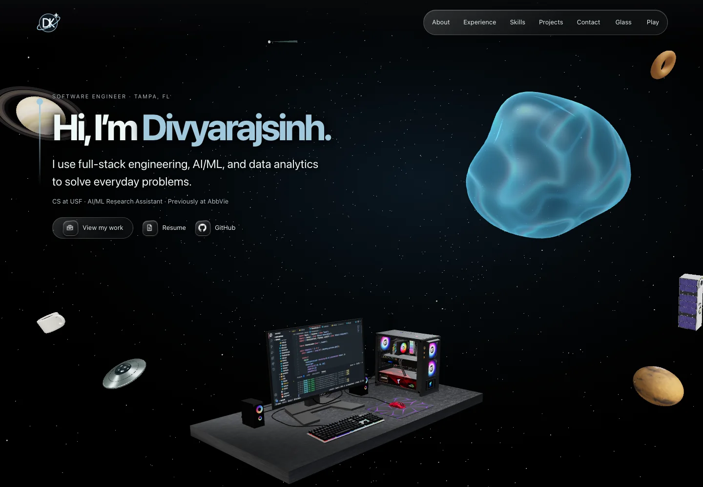
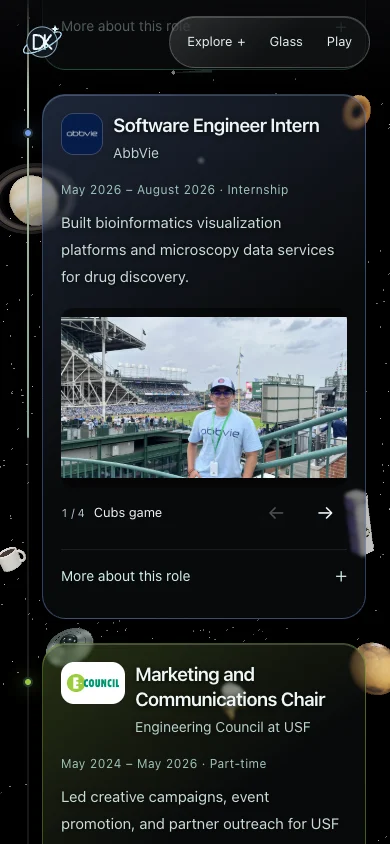

# Divyarajsinh Karmariya · Interactive portfolio

A portfolio you can explore as a small world. The workstation opens the site, an astronaut greets you in About, and a rotating Earth sits beside the contact form. The experience timeline, projects and résumé are regular HTML, so visitors can get straight to the work.

[Visit the portfolio](https://iamdk25.github.io/3d_personal_portfolio/) · [Browse the classic edition](https://iamdk25.github.io/portfolio-classic/)



## Try it

| Where | What to try |
| --- | --- |
| Opening | Move over the liquid sculpture or press it to send a ripple across its surface. Turn the workstation with a mouse, a finger or the arrow keys. |
| About | Drag the spacesuit to inspect it. Scroll away and return to see its visor face forward again. |
| Open space | With motion enabled, catch a drifting object, pull it across the star field and release. A damped spring takes it back to its moving orbit. Swiping between objects scrolls the page. |
| Experience | Open a role to read the full account. Swipe through the AbbVie photos or use the carousel buttons. |
| Skills | Turn each sphere independently. The logos follow the material and its lighting all the way around. |
| Projects and résumé | Explore SkillSharp AI, PAAL, EERIS and QuantumStock. Open the résumé in its glass reader, zoom the page or download the PDF. |
| Navigation | Adjust the glass blur over the moving scene. Pause motion at any time. Keyboard users can tab to controls and close open panels with Escape. |

<table>
<tr>
<td width="50%" align="center"></td>
<td width="50%" align="center"></td>
</tr>
<tr><td align="center">A mouse drag on the actual 3D model</td><td align="center">The internship photo carousel on a phone-sized screen</td></tr>
</table>

## How it works

**Input and motion.** The background and foreground share hit testing so one gesture moves one object. A finger that lands on a model claims the drag before the browser starts scrolling. Open space keeps native touch scrolling. On supported touch devices, enable **Touch vibration** in the Glass panel for distinct navigation, grab, ripple and spring-release patterns. The circular pointer leaves a short fading trail, shows the available action on hover, and responds to pressure where the browser reports it. Desktop wheel scrolling uses Lenis. The initial animation setting follows the visitor’s reduced-motion preference.

**Rendering.** React and Vite deliver the content first. Three.js scenes load near the viewport, stop rendering continuously offscreen, and unmount farther away. All twelve skill spheres share one canvas. The workstation has a compact texture set for small screens and data-saving connections. The spacecraft and workstation share one background Meshopt decoding worker where workers are available, and the reflective objects reuse a prefiltered studio lighting map.

**Glass.** A GPU pass samples the star field and composites a softened image inside the visible pane boundaries. The text and controls sit above that pass. The slider changes the blur radius while objects and stars continue to move.

**Contact and activity.** The contact form loads EmailJS on submission and offers a direct email link if delivery fails. A small Node service stores visit and résumé download-start events in SQLite. It counts page loads, including refreshes, and uses an event ID so a retried request counts once. Visible browser sessions refresh the totals every 12 seconds. The display includes the previously reported 3,000+ visits and 270 download starts.


## Run locally

Use Node.js 22.13 or newer and npm.

```sh
git clone https://github.com/Iamdk25/3d_personal_portfolio.git
cd 3d_personal_portfolio
npm ci
npm run dev
```

Open the address printed by Vite with the path `/3d_personal_portfolio/`. Build and preview the production site with the following commands.

```sh
npm run lint
npm run build
npm run preview
```

To try it on a phone on the same trusted Wi-Fi, run `npm run preview -- --host 0.0.0.0` and open the **Network** address Vite prints, including the portfolio path.

## Project layout

| Path | Contents |
| --- | --- |
| `src/components/canvas/` | The star field, model framing, glass pass, liquid shader, skill materials and spring interactions |
| `src/hooks/` | Gesture ownership, visibility, scroll progress and live activity |
| `src/constants/` | Project descriptions, skills and expandable experience entries |
| `public/models/`, `public/experience/`, `public/resume/` | 3D models, internship photography and the downloadable PDF |
| `server/` | The activity endpoint shared by development, preview and a standalone production service |
| `docs/images/` | Screenshots and a recorded interaction from the portfolio |

## Verification

Chrome and WebKit were exercised with phone, tablet and desktop viewports. The Chrome layout checks spanned 320 to 2560 CSS pixels, including landscape and ultrawide. A separate stable Firefox run covered the 3D scene, keyboard controls, glass settings and résumé. Gesture tests covered touch, mouse and pen input, including switching inputs within a browser session. With WebGL disabled, the project links and résumé reader stayed usable.

Three cold mobile Lighthouse runs against the local production preview scored **91–92 for performance**. First content appeared at **1.7 s**, largest content at **2.6 s**, and layout shift measured **0** in each run. Total blocking time ranged from **220 to 260 ms**. These are simulated mobile lab results. Network conditions, hardware and public hosting affect the timings.

In a phone-sized Chromium browser, four complete trips from the workstation to Earth ended with two canvases, 321 event listeners and 1,244 DOM nodes each time. The JavaScript heap after garbage collection ranged from 9.4 to 10.1 MiB. That measurement excludes GPU memory.

## Hosting

The GitHub Pages workflow builds the frontend and publishes `dist/` under `/3d_personal_portfolio/`. Public live counters require a separate HTTPS Node service with persistent storage. Run `node server/start.js` on that host, set `ACTIVITY_DB` to a file on the persistent disk, and set `SITE_ORIGIN` to the portfolio’s public origin. Set the GitHub repository Actions variable `VITE_ACTIVITY_URL` to the service URL ending in `/api/activity` before building. Local previews use their own database in `.portfolio-data/`.

## Author and artwork

Divyarajsinh Karmariya · [GitHub](https://github.com/Iamdk25) · [LinkedIn](https://www.linkedin.com/in/dkarmariya/)

The workstation is adapted from Yolala1232’s Gaming Desktop PC. The Mark III spacesuit, ICECube satellite and Voyager come from NASA. Planet textures include NASA and Solar System Scope imagery. Model and texture links, licenses and adaptations are listed under **3D credits** in the site footer. [See the credits](src/components/Colophon.jsx)
