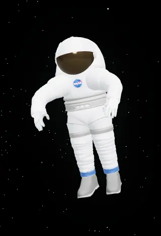
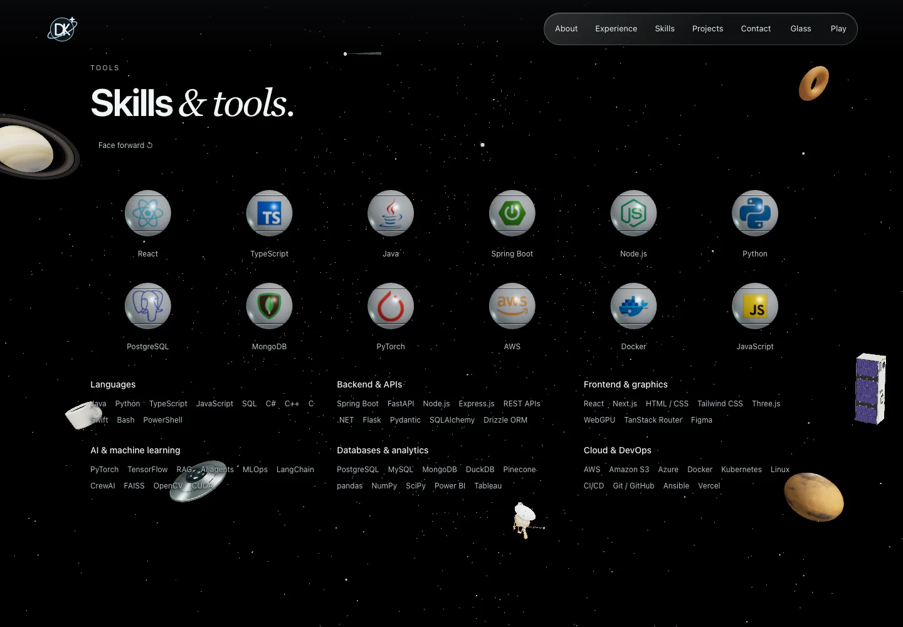

<p align="center"></p>

<h1 align="center">Interactive 3D Portfolio</h1>

<p align="center">Divyarajsinh Karmariya’s work, experience and projects in an interactive star field.</p>

<p align="center">
  <strong><a href="https://iamdk25.github.io/3d_personal_portfolio/">Explore the portfolio</a></strong> &nbsp;·&nbsp;
  <a href="https://iamdk25.github.io/portfolio-classic/">Classic edition</a> &nbsp;·&nbsp;
  <a href="#local-development">Run locally</a>
</p>

<p align="center">
  <a href="https://github.com/Iamdk25/3d_personal_portfolio/actions/workflows/deploy.yml"></a>
</p>

[](https://iamdk25.github.io/3d_personal_portfolio/)

## Explore the scene

Grab a satellite as it passes, pull it away from its orbit and let go. It springs back toward its moving position. On a phone, starting the same gesture in empty space scrolls the page. That distinction runs through the portfolio: each object responds where you touch it, while the writing, project links and résumé remain ordinary, navigable HTML.

| Where | What to try |
| --- | --- |
| Opening | Press the liquid sculpture to send a ripple across its surface. Drag the workstation to turn it, or focus it and use the arrow keys. |
| About & experience | Turn the astronaut around, expand a role in the timeline, or swipe through the AbbVie internship photos. |
| Skills | Rotate any of the twelve spheres. Each logo follows the curvature and lighting of its sphere. |
| Project showcase | Explore SkillSharp AI, PAAL, EERIS and QuantumStock, then follow their project links. |
| Glass & motion | Adjust the glass blur while objects pass behind a pane. Pause motion, or enable optional vibration on a supported touch device. |
| Résumé | Read or zoom the document in the glass viewer, open the accessible PDF in a separate tab, or download a copy. |

<table>
  <tr>
    <th align="center">Rotating the spacesuit</th>
    <th align="center">Experience on mobile</th>
  </tr>
  <tr>
    <td width="50%" align="center"></td>
    <td width="50%" align="center"></td>
  </tr>
</table>

## Engineering

The interface is built with **React and Vite**. **Three.js and React Three Fiber** render the scenes. **Lenis** smooths desktop wheel scrolling.

| Design decision | Implementation |
| --- | --- |
| Keep the first screen light | Load 3D scenes as they approach the viewport, suspend continuous rendering offscreen, and release distant scenes. Small screens and data-saving connections get a compact workstation. |
| Keep twelve skills inexpensive | Render the entire grid with one canvas. Each sphere retains its own rotation and shares the renderer and lighting with its neighbors. |
| Keep glass aligned with moving objects | Sample the star field in a GPU pass, soften it inside the pane boundaries, and draw the text and controls above it. |
| Give each gesture one owner | Foreground and background models share hit testing. Pointer cues identify the available action, touch supports direct manipulation, and focusable models support arrow keys. The initial motion setting respects the visitor’s preference. |

<details>
<summary>View the skill spheres</summary>



</details>

## Local development

Use **Node.js 22.13 or later** and npm. The local activity service uses Node’s built-in SQLite support.

```sh
git clone https://github.com/Iamdk25/3d_personal_portfolio.git
cd 3d_personal_portfolio
npm ci
npm run dev
```

Open the local address printed by Vite at the path `/3d_personal_portfolio/`.

| Command | Purpose |
| --- | --- |
| `npm run lint` | Run ESLint |
| `npm run build` | Generate the production site in `dist/` |
| `npm run preview` | Serve the production build locally |
| `npm run preview -- --host 0.0.0.0` | Test the build on a phone using Vite’s network address on the same trusted Wi-Fi |

### Where to make changes

| Area | Location |
| --- | --- |
| Experience, skills and featured projects | [Content definitions](src/constants/) |
| Models, shaders, lighting and scene interactions | [Canvas components](src/components/canvas/) |
| Touch input, scroll behavior and visibility | [Interaction hooks](src/hooks/) |
| Models, photos and résumé files | [Public assets](public/) |
| Visit and download counters | [Activity service](server/) |

## Verification

Three cold-load Lighthouse runs against the **local production build** produced the following results with simulated mobile throttling.

| Mobile metric | Result |
| --- | --- |
| Performance score | 91–92 |
| First / largest contentful paint | 1.7 s / 2.6 s |
| Total blocking time | 220–260 ms |
| Cumulative layout shift | 0 |

Browser checks covered Chrome, WebKit and Firefox. Layout checks in Chrome spanned 320–2560 CSS pixels. Interaction checks included touch drags, mouse and pen input, keyboard navigation, reduced motion and accessing projects and the résumé with WebGL disabled.

## Deployment

The [Pages workflow](.github/workflows/deploy.yml) builds `main` and publishes `dist/` at the original portfolio address. The [classic edition](https://github.com/Iamdk25/portfolio-classic) is hosted independently with its original models and textures.

<details>
<summary>Contact form and optional live counters</summary>

The form loads EmailJS when a visitor submits a message. If you adapt this project, configure your own EmailJS service, template and public key in the [contact component](src/components/Contact.jsx).

Local development and preview use a SQLite database in `.portfolio-data/`. For public live counts, run `node server/start.js` on an HTTPS-backed host with persistent storage and configure the following values.

| Setting | Where | Value |
| --- | --- | --- |
| `ACTIVITY_DB` | Node service | Path to the persistent SQLite file |
| `SITE_ORIGIN` | Node service | The frontend origin, such as `https://iamdk25.github.io` |
| `VITE_ACTIVITY_URL` | GitHub Actions repository variable | The public service URL ending in `/api/activity` |

Rebuild the frontend after changing the endpoint. The service counts visits, including refreshes, and résumé download starts. Event IDs prevent retries from counting twice. With the service configured, visible sessions refresh totals every 12 seconds. The static site otherwise labels the previously reported totals as historical.

</details>

## Credits

Designed and developed by **Divyarajsinh Karmariya**. [GitHub](https://github.com/Iamdk25) · [LinkedIn](https://www.linkedin.com/in/dkarmariya/)

The workstation is adapted from Yolala1232’s *Gaming Desktop PC*. The Mark III spacesuit, ICECube satellite and Voyager models come from NASA. Planet textures include NASA and Solar System Scope imagery. The portfolio’s **3D credits** list the individual sources, licenses and adaptations. [Model and artwork credits](src/components/Colophon.jsx)
